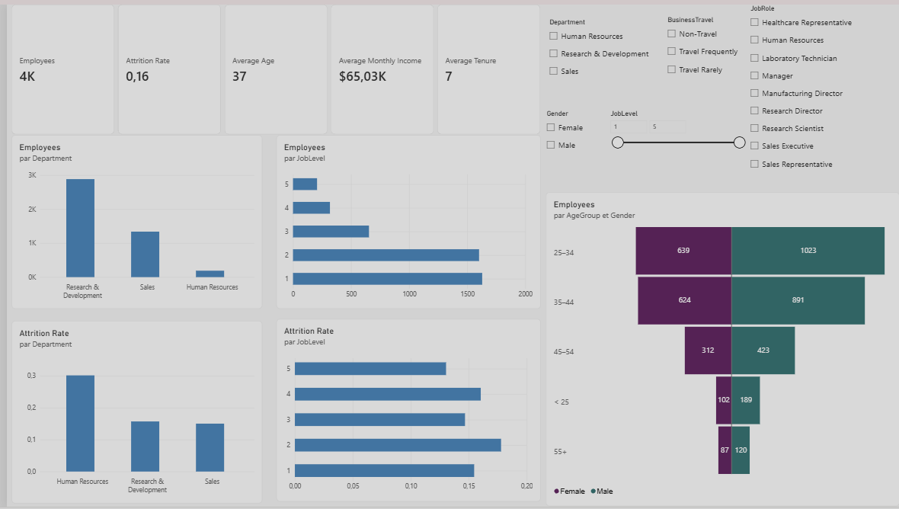
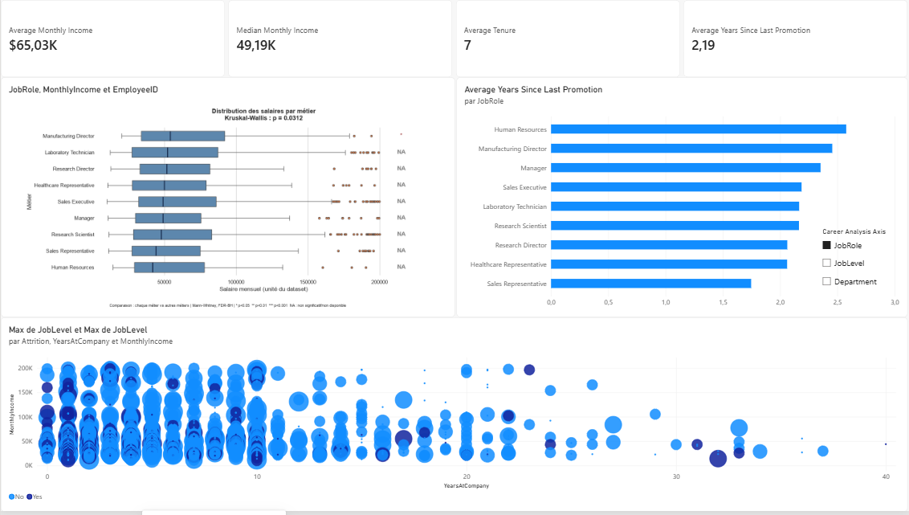
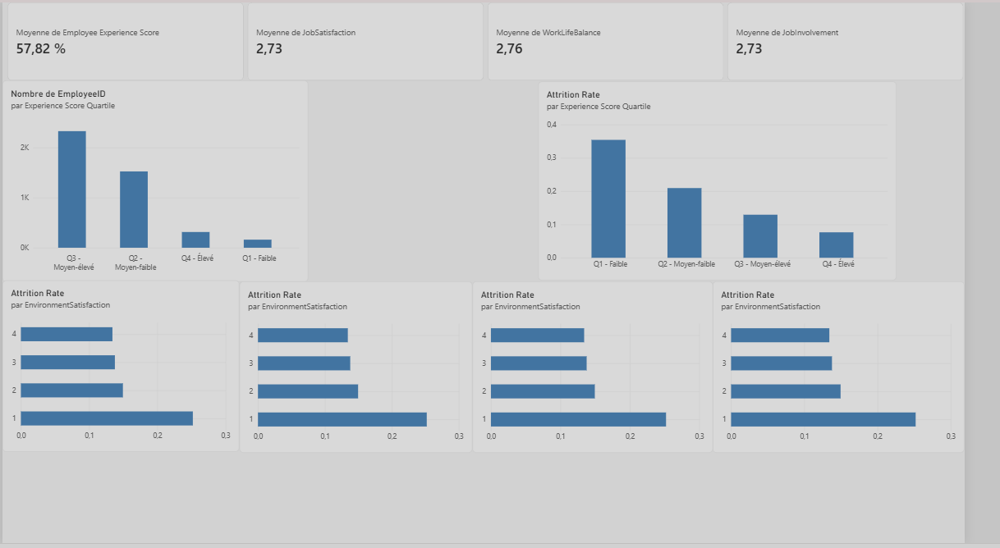
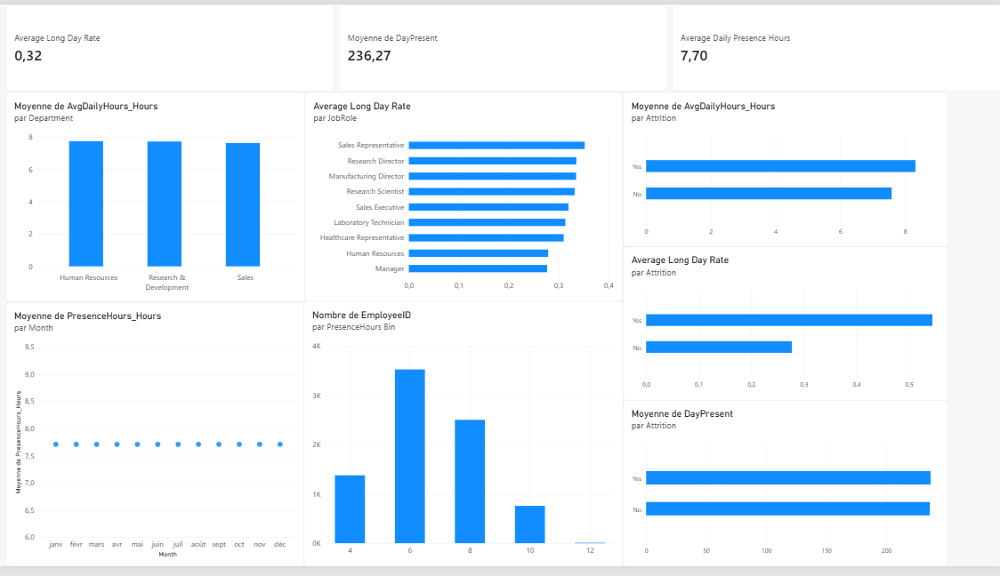

# 03 — Workforce Analytics & Attrition | Power BI

**An interactive HR analytics case study covering workforce composition, employee attrition, compensation, employee experience and attendance.**

**Tools:** Power BI Desktop · Power Query (M) · DAX · Python (statistical visualisation)  
**Data:** Public, educational HR case-study dataset (synthetic/simulated; not real IBM employee records)  
**Report:** [`03-Workforce Analytic and attrition_cleaned.pbix`](03-Workforce%20Analytic%20and%20attrition_cleaned.pbix)

> **Portfolio project, not a production HR decision system.** The analyses are descriptive and exploratory. Relationships between variables and attrition should not be interpreted as causal effects or as an employee-level prediction.

## 1. Business context & objectives

Employee turnover can affect recruitment workload, continuity and retention costs. This project brings together multiple HR datasets in a single Power BI report to explore four questions:

1. **Workforce:** How is the workforce distributed across departments, job levels, ages and genders? Where are attrition rates higher?
2. **Compensation & career:** How do salary distributions vary across roles? How do tenure and time since last promotion differ across employee groups?
3. **Employee experience:** How are satisfaction, work–life balance, job involvement and a composite experience score associated with attrition?
4. **Attendance:** How do presence hours, long-day frequency and days present compare across departments, roles and attrition groups?

## 2. Dashboard preview

The following screenshots show the report pages and key analysis areas.

### Workforce overview

Headcount, attrition rate, age, income and tenure KPIs; department and job-level comparisons; age–gender distribution; interactive employee filters.

### Compensation & career

Income statistics; salary distributions by job role using a Python box plot; time since last promotion, with selectable career breakdowns; tenure versus income scatter plot segmented by attrition.

### Employee experience

Experience and satisfaction KPIs; distribution of employees across experience-score quartiles; attrition rates by quartile and satisfaction level.

### Attendance & working patterns

Attendance indicators and comparisons across departments, job roles and attrition groups, including a presence-hours distribution.

## 3. Data sources

Five complementary input files are used, alongside a data dictionary:

| File | Contents / analytical use |
|---|---|
| `general_data.csv` | Employee profile, job characteristics, tenure, compensation and attrition |
| `employee_survey_data.csv` | Job satisfaction, work–life balance and other employee-reported scores |
| `manager_survey_data.csv` | Manager-assessed employee indicators |
| `in_time.csv` | Employee check-in records by date |
| `out_time.csv` | Employee check-out records by date |
| `data_dictionary.xlsx` | Field definitions and coding |

Raw data files are located in [`data/`](data/).

## 4. Data preparation & model

The main technical challenge is combining **employee-level information** with **daily attendance data** stored in wide-format files.

- Clean and standardise source columns and data types in **Power Query**.
- Reshape check-in and check-out matrices from wide to long format (**unpivot**) to obtain employee–date observations.
- Join attendance information by **employee and date**, rather than using `EmployeeID` alone as a unique daily-record identifier.
- Prepare attendance aggregates for employee-level reporting and connect them with HR and survey information.
- Use relationships and DAX filter context to calculate dynamic KPIs across interactive segments.

This workflow demonstrates multi-source integration, data granularity management and modelling for interactive BI.

## 5. Analytical features

| Area | Examples of implemented analyses |
|---|---|
| Workforce | Headcount, attrition rate, workforce mix by department/job level, demographic breakdown |
| Career & compensation | Average and median income, average tenure, years since promotion, income distributions and outliers |
| Employee experience | Composite experience score, score quartiles, satisfaction indicators and corresponding attrition rates |
| Attendance | Average presence hours, long-day rate, days present, comparisons by department/job role/attrition |

**Employee Experience Score:** A project-specific composite indicator derived from selected employee-experience dimensions. It is intended for exploratory comparison, **not** as a validated psychological or HR assessment.

**Statistical visualisation:** The salary box plot uses Python to show dispersion, median, quartiles and potential outliers, with a Kruskal–Wallis comparison displayed in the figure. A test result indicates differences between groups, not their causes.

## 6. Key observations from the dashboard

- Attrition rates vary across departments and employee-experience categories.
- Lower experience-score quartiles have higher observed attrition rates in the displayed report.
- Compensation distributions are dispersed within job roles; box plots make this easier to see than averages alone.
- Attendance behaviour can be compared between employee groups, but these comparisons require careful interpretation.

These are **descriptive associations within the case-study dataset**; they do not establish why an employee leaves.

## 7. Open the report

1. Download or clone this repository.
2. Open [`03-Workforce Analytic and attrition_cleaned.pbix`](03-Workforce%20Analytic%20and%20attrition_cleaned.pbix) in **Power BI Desktop**.
3. If prompted, update the source paths to the CSV files under [`data/`](data/), then refresh the model.
4. For Python visuals, configure a compatible local Python installation and the required plotting/statistics libraries in Power BI Desktop. Python visuals may not be available in every viewing or licensing environment; the screenshot above shows the rendered result.

## 8. Scope & limitations

- The dataset is educational/simulated; the dashboard is a **portfolio demonstration**, not a live company HR dashboard.
- Attrition is analysed retrospectively; there is no validated predictive model or causal identification in this project.
- Aggregated comparisons can be affected by group composition and data quality.
- The exact definitions and units of the custom attendance and compensation measures should be checked in Power BI before drawing numerical conclusions. In particular, reconcile the displayed daily-hours KPI with the hours shown in the attendance charts.

## 9. Skills demonstrated

**Power BI** · **Power Query (M)** · **DAX** · Data cleaning and integration · Data modelling and relationships · HR analytics · KPI design · Interactive filtering · Exploratory statistics · Python visualisations · Data storytelling

---

[← Back to Power BI portfolio](../README.md)
